# DBMonitor

**Real-Time Oracle Database Monitoring Tool**

DBMonitor is a desktop application developed as a final apprenticeship project during my training as an IT Specialist for Application Development (*Fachinformatiker für Anwendungsentwicklung*). It provides a centralized interface for monitoring Oracle database activity, inspecting SQL statements, analyzing resource-intensive processes, tracking scheduled jobs, and investigating database locks.

The application was built to support database administrators in identifying potential performance issues, analyzing active sessions, and documenting critical administrative operations.

## Features

- **Real-Time Dashboard** — Overview of active database sessions, scheduled jobs, and database locks.
- **Active Session Monitoring** — Inspect Oracle sessions, connection details, and currently executed SQL statements.
- **SQL Inspection** — View formatted SQL statements, inspect bind variables, and review parsing information.
- **SQL Performance Analysis** — Examine SQL execution statistics and identify resource-intensive statements.
- **Process Monitoring** — Analyze database processes and their PGA memory consumption.
- **Oracle Job Monitoring** — Inspect scheduled jobs, execution statuses, run history, and execution details.
- **Lock Analysis** — Identify database lock conflicts, blocking sessions, and related SQL statements.
- **Session and Lock Management** — Initiate administrative termination workflows with mandatory justification.
- **Audit Logging** — Review recorded administrative operations and their associated metadata.

## Application Screenshots

### 1. Dashboard Overview

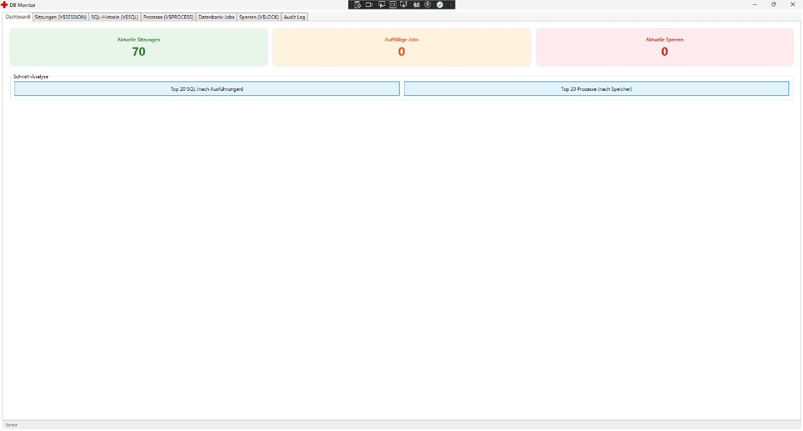

Central dashboard displaying key database monitoring metrics, including active sessions, database jobs, and locks.

### 2. Active Sessions Monitoring (`V$SESSION`)

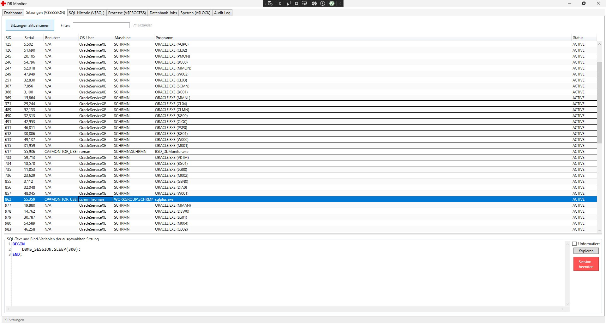

Monitoring interface for active Oracle sessions, including session identifiers, operating system users, client machines, and associated SQL statements.

### 3. Session Termination and Audit Prompt

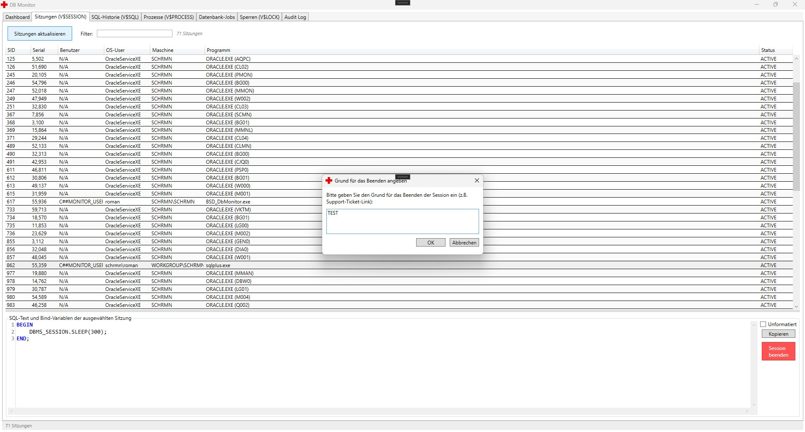

Session termination workflow requiring a justification before the administrative operation can proceed, supporting traceability of critical actions.

### 4. External Workload Simulation with SQL*Plus

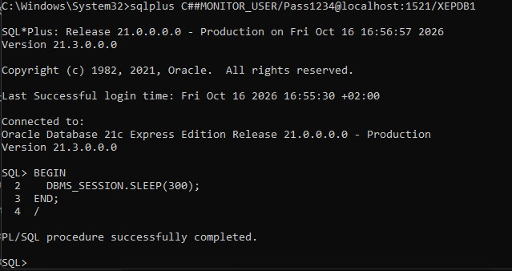

SQL*Plus session used to generate database activity for testing session monitoring and termination scenarios.

### 5. SQL and Bind Variable Inspector

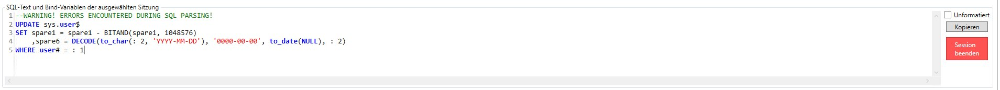

SQL inspection view featuring formatted query text, bind variable information, and parsing-related feedback.

### 6. SQL Execution History and Performance Analysis (`V$SQL`)

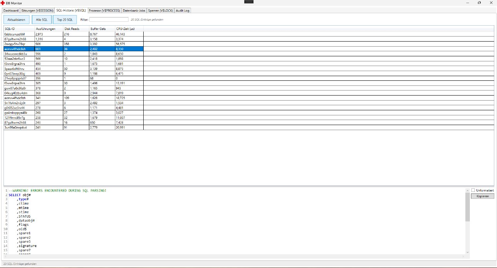

Analysis of resource-intensive SQL statements using execution statistics such as execution counts, buffer gets, disk reads, and CPU consumption.

### 7. Database Process Monitoring (`V$PROCESS`)

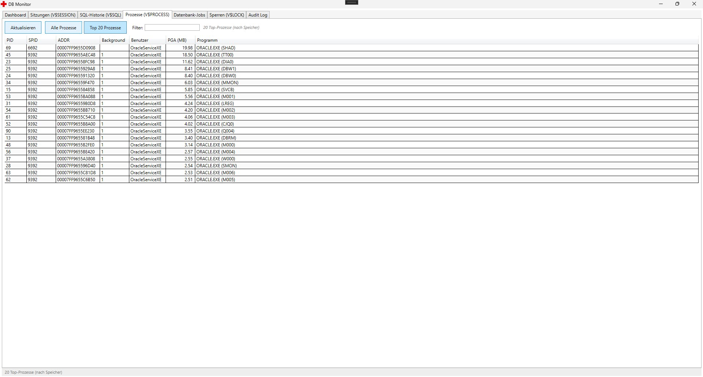

Process overview highlighting database process metadata and PGA memory consumption to help identify resource-intensive processes.

### 8. Oracle Scheduler and Database Jobs

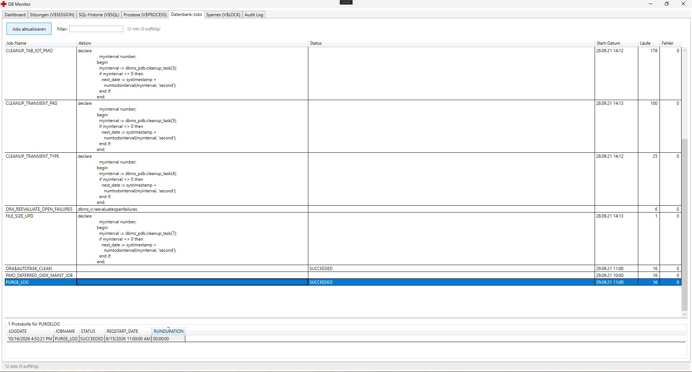

Monitoring view for scheduled database jobs, including execution status, historical runs, failure statistics, and available job details.

### 9. Lock Conflict Simulation with SQL*Plus

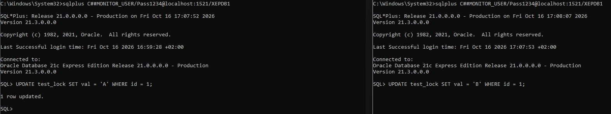

Multiple SQL*Plus sessions used to reproduce transaction locking scenarios and validate the application's lock monitoring functionality.

### 10. Database Lock and Contention Analysis (`V$LOCK`)

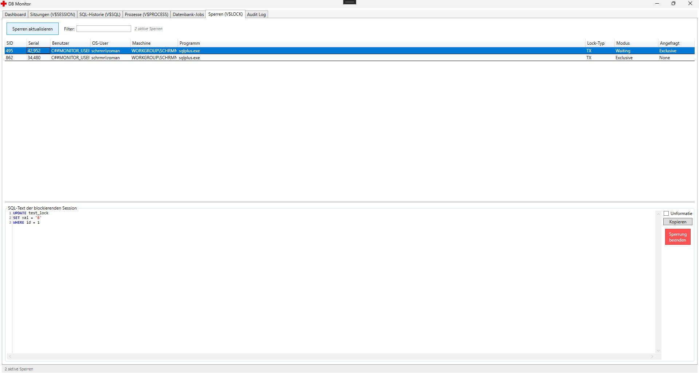

Lock monitoring interface for examining active transaction locks, lock modes, blocking relationships, and SQL statements associated with blocking sessions.

### 11. Lock Resolution and Justification Prompt

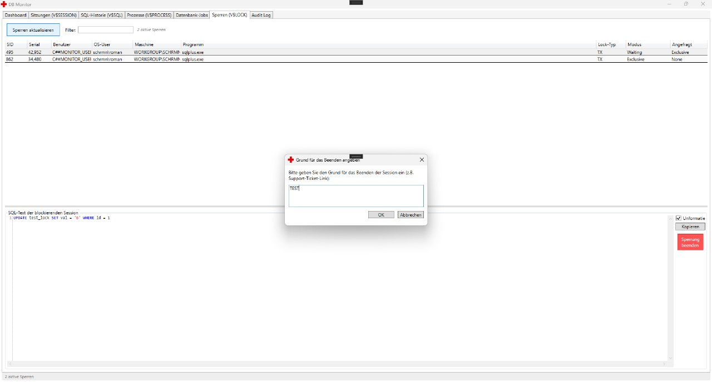

Administrative lock resolution workflow requiring a justification before the operation is carried out.

### 12. Audit Trail and Administrative Operations

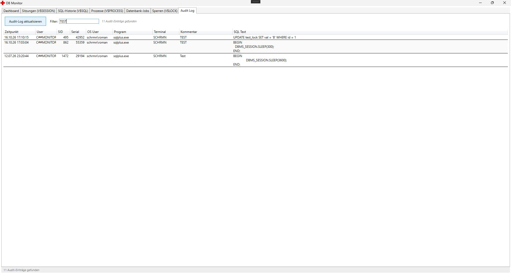

Audit log showing recorded administrative operations with timestamps, user and session details, justifications, and associated SQL statements where available.

## Technology Stack

| Technology | Purpose |
|---|---|
| C# | Application development |
| .NET Framework 4.8 | Desktop application runtime |
| WPF | Desktop user interface |
| MVVM | Separation of presentation and application logic |
| Prism EventAggregator | Communication between application components |
| Oracle Managed Data Access | Oracle database connectivity |
| Oracle Database | Database monitoring and metadata queries |
| SQL and PL/SQL | Database queries and interaction |

## Architecture and Implementation

DBMonitor was developed as a WPF desktop application using the MVVM architectural pattern to separate the user interface from application logic.

Key implementation aspects include:

- Modular communication between components using Prism's EventAggregator.
- Oracle database connectivity through Oracle Managed Data Access.
- Monitoring of Oracle session, SQL, process, job, and lock information.
- SQL statement inspection and bind variable analysis.
- Administrative workflows for session termination and lock resolution.
- Audit-oriented documentation of critical administrative operations.

The project was developed using an iterative approach with **three Scrum sprints** and a planned effort of **80 hours**.

## Testing and Results

The completed project was tested against its defined requirements. The final project documentation recorded **8 out of 8 tests passed**.

The implemented solution was designed to reduce manual database monitoring effort and simplify the investigation of active sessions, SQL statements, resource consumption, and locking issues.

## Project Context

DBMonitor was developed as my final project during my apprenticeship as a *Fachinformatiker für Anwendungsentwicklung*.

The project combines C# desktop application development, Oracle database programming, SQL analysis, application architecture, and database administration workflows in a practical monitoring tool.

## Author

**Roman Schesler**

- GitHub: [romsches](https://github.com/romsches)

